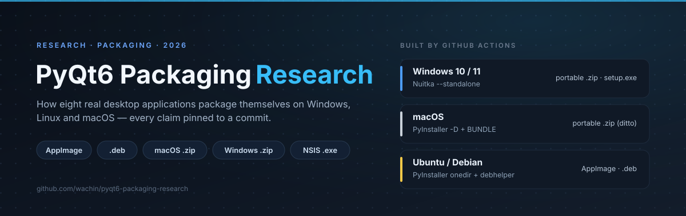

# PyQt6 Packaging Research



[](LICENSE)
[](https://github.com/wachin/pyqt6-packaging-research/releases)
[](https://github.com/wachin/pyqt6-packaging-research/actions/workflows/release-skills.yml)


How eight real PyQt6 desktop applications get built, packaged, installed and
released on Windows, Linux and macOS — read from their own build files, pinned to
commits, and turned into something you can hand to an AI agent.

The research is finished. This README is about **using** it.

## What it answers

| Artifact | Platform | Tool this research validates |
|---|---|---|
| **AppImage** | Ubuntu, Debian, any glibc ≥ your floor | PyInstaller `onedir` in a hand-built AppDir, `appimagetool` pinned and checksummed |
| **`.deb`** | Ubuntu, Debian, policy-compliant | debhelper + pybuild, depending on the distro's `python3-pyqt6` |
| **macOS `.zip`** | macOS | PyInstaller `-D` + `BUNDLE`, archived with `ditto` |
| **Windows portable `.zip`** | Windows 10/11 | **Nuitka `--standalone`** |
| **Windows `setup.exe`** | Windows 10/11 | the same Nuitka payload, wrapped in **NSIS** (`.nsi`) or Inno Setup |

All five are produced by a **GitHub Actions workflow**, not by hand: one job per
artifact, each on the runner its toolchain needs, then a release job that attaches
the results. That is how both of the owner's applications ship, and it is the shape
the Skills and the studies describe.

Windows is Nuitka on purpose — see [the antivirus question](#the-antivirus-question).

---

## Two ways to use this

### 1. Point your agent at the folder — no Skills needed

Everything a person or an agent needs is in one directory,
[`PYQT6-GENESIS-PACKAGING/`](PYQT6-GENESIS-PACKAGING/). Open your PyQt6 project,
paste this, and adjust the paths to where this repository sits on your machine:

```text
My PyQt6 program is now ready, and I would like you to create installers for it,
specifically:

- AppImage (for Ubuntu, Debian)
- .deb package (for Ubuntu, Debian — must comply with Debian's packaging policies)
- Portable package for macOS (created using PyInstaller)
- Portable program for Windows 10/11 (created using Nuitka, ensuring it does not
  trigger virus alerts on VirusTotal.com)
- .exe installer (using .nsi scripts) for Windows 10/11 (created using Nuitka,
  ensuring it does not trigger virus alerts on VirusTotal.com)

Build them with GitHub Actions, the way the research does it: the artifacts should
be produced by a workflow in CI and attached to a release, not built on my machine.

Read this folder first. It is the reference, not a survey:

PYQT6-GENESIS-PACKAGING/wachin-PyQt6-Apps/lucio-iva-calculator-results

Its Windows executables are built with Nuitka and its NSIS installer was scanned
clean on VirusTotal.com — 0/68, the project's own record — and the whole recipe is
written down there: the Nuitka flags, the PE version metadata, and the .nsi script
itself. Copy that Windows recipe instead of inventing one. A second application of
mine, TBO, builds its Windows portable the same way and also scans clean:

PYQT6-GENESIS-PACKAGING/wachin-PyQt6-Apps/TBO-results

What carries over is the installer's shape, not only its settings: MUI version 1
rather than MUI2, six pages including the components page, four sections plus the
uninstall section, a header and a welcome bitmap, XPStyle, and a pinned makensis
version. A minimal five-page, one-section installer compiles and installs and is
the variant that gets flagged, so start from the .nsi in that folder's _evidence/
and keep its layout.

Produce the artwork as well, as that reference does: a 150x57 header bitmap and a
164x314 welcome bitmap, both 24-bit BMP, and a multi-resolution .ico for the
application itself at 16, 24, 32, 48, 64, 128 and 256 px, so the shortcut, the
taskbar and the file listing each get the size they need.

If you hit something specific to PyQt6 that this folder does not answer, look here:

PYQT6-GENESIS-PACKAGING/external-PyQt6-Apps

It holds six other projects — CARA, CustomKnight-Creator, dikte, napari,
napari/packaging and pyzo — studied the same way, each with a PACKAGING_STUDY.md, a
PYQT6_PACKAGING_TUTORIAL.md and the real packaging files in _evidence/. Treat them
as a fallback for a problem you are stuck on, not as the thing to copy: they solve
different problems, and none of them was built with VirusTotal in mind.
```

Three things make that prompt work, and they are worth knowing so you can steer
the agent afterwards:

- **Start it inside your project, not here.** This repository is a research
  archive; an agent working in it will read studies instead of building your app.
  Copy `PYQT6-GENESIS-PACKAGING/` next to your project, or point at it by absolute
  path.
- **Ask it to name the closest analogue.** "Which of these projects is closest to
  mine, and what did it do?" gets a better build than "implement all five
  artifacts" — a `.deb` with a `src/` layout and a Qt6 app with a `debian/`
  directory already present have different starting points.
- **Tell it your app's real shape**: entry point, `src/` or flat, resources,
  translations, Qt modules you import beyond QtWidgets.
- **Also say "build it in GitHub Actions".** It is not a style preference: the
  Windows and macOS artifacts can only be produced on their own operating systems,
  so a workflow with one job per artifact is how both applications in this research
  actually ship.

Inside that folder, every project has a `PACKAGING_STUDY.md` (what it does, with
line citations), a `PYQT6_PACKAGING_TUTORIAL.md` (how to do it), and `_evidence/`
(the real packaging files copied out of the project). The
[folder's own README](PYQT6-GENESIS-PACKAGING/README.md) maps which project answers
which artifact, and it is the page to read before you delegate.

### 2. Install the Skills

Six Skills turn the same research into loadable procedure — one per decision and
per artifact, each with a "what is NOT verified here" section. They are ordinary
`SKILL.md` files, so they work in more than one harness.

#### DeepSeek Harness

A Skill is a directory containing `SKILL.md`, one level below a skill root. Lower
rank wins when two roots define the same name:

| Rank | Location | Scope |
|---|---|---|
| 100 | `<project>/.dsh/skills/` | this project, committed |
| 200 | `<project>/.agents/skills/` | this project, shared agents convention |
| 400 | `~/.dsh/skills/` | every project on this machine |
| 500 | `~/.agents/skills/` | every project, shared agents convention |

**Install once for all your projects:**

```bash
mkdir -p ~/.dsh/skills
curl -fsSL https://github.com/wachin/pyqt6-packaging-research/releases/download/skills-v1.1.0/pyqt6-packaging-skills-1.1.0.tar.gz \
  | tar -xz -C ~/.dsh/skills
```

Verify the download first if you prefer:

```bash
base=https://github.com/wachin/pyqt6-packaging-research/releases/download/skills-v1.1.0
curl -fsSLO "$base/pyqt6-packaging-skills-1.1.0.tar.gz"
curl -fsSLO "$base/SHA256SUMS"
sha256sum -c SHA256SUMS
```

**Or track `git pull`**, which keeps them live because the harness follows
symlinks:

```bash
git clone https://github.com/wachin/pyqt6-packaging-research.git ~/src/pyqt6-research
mkdir -p ~/.dsh/skills
ln -sfn ~/src/pyqt6-research/.dsh/skills/* ~/.dsh/skills/
```

Check that they loaded: the catalog should list all six names —
`pyqt6-packaging-decisions`, `pyqt6-deb-packaging`, `pyqt6-appimage-packaging`,
`pyqt6-macos-signing-notarization`, `pyqt6-windows-installer-signing`,
`pyqt6-release-integrity`. A Skill whose YAML frontmatter is invalid is skipped
with a warning rather than an error, so if five appear instead of six, look for the
warning.

Both the tag (`skills-v1.1.0`) and the version in the filename change with each
release; if the download 404s, `gh release list` (or the releases page) shows what
exists now.

Then just ask for the work: *"package this app as a .deb"*. The agent loads the
relevant Skill by name. Start with `pyqt6-packaging-decisions` if you are still
choosing.

#### opencode

opencode reads the same `SKILL.md` format from six locations, three project-level
and three global ([docs](https://opencode.ai/docs/skills/)):

| Scope | Locations |
|---|---|
| Project | `.opencode/skills/<name>/SKILL.md`, `.claude/skills/<name>/SKILL.md`, `.agents/skills/<name>/SKILL.md` |
| Global | `~/.config/opencode/skills/<name>/SKILL.md`, `~/.claude/skills/<name>/SKILL.md`, `~/.agents/skills/<name>/SKILL.md` |

For a project it walks up from the working directory to the git worktree, so a
`skills/` directory above your current subdirectory is still found.

**These six Skills need no conversion.** Checked against opencode's rules: the
names match `^[a-z0-9]+(-[a-z0-9]+)*$`, all are under 64 characters, each matches
its directory name, and every `description` is between 184 and 214 characters
(the limit is 1024). The one field opencode does not use is `whenToUse`; it ignores
unknown fields rather than failing.

**Install globally — the same archive, a different root:**

```bash
mkdir -p ~/.agents/skills
curl -fsSL https://github.com/wachin/pyqt6-packaging-research/releases/download/skills-v1.1.0/pyqt6-packaging-skills-1.1.0.tar.gz \
  | tar -xz -C ~/.agents/skills
```

**Or per project**, so the whole team gets them with a clone:

```bash
mkdir -p .opencode/skills
curl -fsSL https://github.com/wachin/pyqt6-packaging-research/releases/download/skills-v1.1.0/pyqt6-packaging-skills-1.1.0.tar.gz \
  | tar -xz -C .opencode/skills
```

#### Both harnesses at once

`~/.agents/skills/` is read by **both** DeepSeek Harness (rank 500) and opencode.
Installing there once covers both:

```bash
mkdir -p ~/.agents/skills
curl -fsSL https://github.com/wachin/pyqt6-packaging-research/releases/download/skills-v1.1.0/pyqt6-packaging-skills-1.1.0.tar.gz \
  | tar -xz -C ~/.agents/skills
```

The archive puts the six skill directories at its top level and a `_meta/`
directory beside them with the licence, the install notes and the verification
report. `_meta/` is skipped by both harnesses because it has no `SKILL.md`.

#### What to ask for once they are installed

You do not have to name the Skills: each one is loaded on demand, and the agent
sees their names and descriptions in its catalog, so *"package this app"* is often
enough. But selection is a judgement call, and a vague request ("make it work on
Windows") can pick the wrong one or none. This removes the doubt:

```text
My PyQt6 program is ready and I want to ship it. I need these artifacts:

- AppImage (for Ubuntu, Debian)
- .deb package (for Ubuntu, Debian - must comply with Debian's packaging policies)
- Portable package for macOS (PyInstaller)
- Portable program for Windows 10/11 (Nuitka, so it does not trigger virus alerts
  on VirusTotal.com)
- .exe installer using .nsi scripts for Windows 10/11 (Nuitka, same reason)

Use the PyQt6 packaging Skills that are installed. Start with
pyqt6-packaging-decisions, follow it, and load the Skill for each artifact as you
reach it. Build everything with GitHub Actions workflows, as the Skills describe,
and give me the workflow files as part of the result.

Before you start, ask me anything you need about my project's shape: entry point,
src/ layout or flat, resources, translations, and which Qt modules I import.
```

Three things worth knowing about how that works:

- **Explicit invocation exists.** In DeepSeek Harness you can force one Skill by
  typing `/pyqt6-deb-packaging` in the message — a slash followed by the exact
  name, surrounded by whitespace. In opencode, name the Skill and ask for it.
- **Installing is not loading.** The agent reads a name and one description, not
  the whole procedure, until it decides to load it. That is the point — six Skills
  cost a few hundred tokens until one is needed.
- **If the agent ignores them**, check that they are visible: the catalog lists six
  names, and a Skill with broken frontmatter is skipped with a warning rather than
  an error. An explicit `/name` in the message settles it.

#### opencode: permissions and troubleshooting

Skills are plain instructions but they can run commands, so opencode lets you
gate them in `opencode.json`:

```json
{
  "permission": {
    "skill": {
      "*": "allow",
      "pyqt6-*": "allow",
      "internal-*": "deny"
    }
  }
}
```

`allow` loads immediately, `ask` prompts, `deny` hides the Skill entirely.
Wildcards work, and the same block can be set per agent.

If a Skill does not appear: confirm the filename is `SKILL.md` in all caps, that
the frontmatter has both `name` and `description`, that the name is unique across
all six locations, and that no permission rule denies it.

---

## What is inside the repository

| Path | What it is |
|---|---|
| `PYQT6-GENESIS-PACKAGING/` | **Start here.** Every study in one folder with English directory names, for pointing a person or an agent at. `wachin-PyQt6-Apps/` is the Windows reference; `external-PyQt6-Apps/` is the fallback shelf. |
| `03-Promt-MAESTRO-resultado/` | The consolidated result: `MASTER_PYQT6_PACKAGING_GUIDE.md`, `PYQT6_MASTER_PACKAGING_TUTORIAL.md`, and `PACKAGING_EVIDENCE_MATRIX.md` with a confidence label on every claim. |
| `01-GENESIS/`, `02-Promt-MAESTRO/` | Provenance: where the research started and the master prompt used for the second-level analysis. Not needed to use the results. |
| `PYQT6-GENESIS-PACKAGING/external-PyQt6-Apps/` | The six external case-study packs, and the only copy of them. |
| `my-PyQt6-Apps/<app>-resultados/` | The two owner applications' packs, maintained as a source plus a mirror under `PYQT6-GENESIS-PACKAGING/wachin-PyQt6-Apps/`. |
| `.dsh/skills/` | The six Skills, source of truth for the release bundle. |
| `experiments/pyinstaller-vs-nuitka/` | The repeatable build-tool experiment kit, with the VirusTotal screenshots. |
| `tools/` | `extract_evidence.py` (regenerates the packs), `build_skills_bundle.py`, `check_genesis_pack.py`. |
| `assets/` | The cover above, as SVG (what the README uses) and as a 2400×760 PNG for anywhere that will not render SVG. |
| `SKILLS.md`, `SKILLS-VERIFICATION.md` | What the Skills cover, and the audit of what they do not. |
| `AGENTS.md` | Rules for AI agents working *in this repository*. Read it before letting one loose here. |
| The eight submodules | The real projects, as **exhibits**. |

### Clone it

```bash
git clone --recurse-submodules https://github.com/wachin/pyqt6-packaging-research.git
```

The eight submodules are the studied applications themselves — full source trees,
none of which is a dependency of anything here. If you only want the research,
`--depth 1` without submodules is enough to read the studies; the evidence packs
are already inside the repository.

---

## The freezer decision, per platform

| Platform | Use | Why |
|---|---|---|
| Windows | **Nuitka `--standalone`** | The only measurements that exist point that way, and it costs nothing extra for a directory-shaped release. Never `--onefile`. |
| Linux | PyInstaller `onedir` | Both owner applications use it there and their artifacts scan clean. Build on the *oldest* distro you support, or the binary will not run on older glibc. |
| macOS | PyInstaller `-D` + `BUNDLE` | The documented path, and what every project here uses. Build per architecture. |

## The antivirus question

This is the reason many people land here, so here is the honest state of it.

Two freezer measurements exist, both Windows-only, plus one installer
measurement from 2026-10:

| Build | VirusTotal |
|---|---|
| Nuitka standalone (TBO, 2026-10) | **0 / 71** |
| PyInstaller onedir (TBO) | **3 / 73** |
| PyInstaller onefile (TBO) | **3 / 73** |
| PyInstaller onefile, bootloader rebuilt from source (TBO) | **2 / 70** |
| Nuitka NSIS installer / portable ZIP (Lucio, 2026-06, self-reported) | **0 / 68** / **0 / 65** |
| NSIS installer over a Nuitka payload, minimal script (ksnip-pyqt6, 2026-10) | **1 / 70** |
| Same payload, reference installer layout (ksnip-pyqt6, 2026-10) | **0 / 67** |

Read the freezer rows as: **two applications, one platform, one of them
self-reported.** It is a
consistent direction, not a law. The four arms also settle two things that sound
plausible and are wrong — `onedir` is *not* a remedy (both PyInstaller layouts
scored identically), and rebuilding the bootloader is *not* a remedy either
(3/73 became 2/70). What remains is the embedded CPython runtime and PyInstaller's
archive format.

The last two rows are a different experiment and they change the question. Four
installers were built from **one identical Nuitka payload** — same 662 files, same
92 MB — and only the wrapper changed: the minimal NSIS script drew a detection
from one engine, and the script that mirrors the reference layout did not. The
portable ZIP of that payload was clean every round. In that experiment the
freezer was never a variable; the installer was.

So: prefer Nuitka on Windows. Do not promise anyone a clean scan. Do not generalise
to your app without measuring — `experiments/pyinstaller-vs-nuitka/` is the kit —
and remember that the installer is a variable of its own, worth controlling
before you go looking for a new freezer. Never answer a false positive with
obfuscation, packing or binary mutation: report it to the vendor. Details and the
per-engine lists are in `03-Promt-MAESTRO-resultado/PACKAGING_EVIDENCE_MATRIX.md` §B.1;
the installer experiment is in
`my-PyQt6-Apps/lucio-iva-calculator-resultados/INSTALLER_WRAPPER_EXPERIMENT.md`.

## For AI agents working in this repository

Read [`AGENTS.md`](AGENTS.md) first. The short version: **the eight studied projects
are exhibits, not dependencies** — never import them, never add them to a manifest,
never modify or commit inside them, never update them. Their citations are pinned to
a commit, and moving the pin invalidates the research.

If you change a study or a Skill, two checks must stay green:

```bash
python3 tools/check_genesis_pack.py         # the reader-facing copy is in sync
python3 tools/build_skills_bundle.py --version 1.0.0   # Skills still bundle
```

## Licence

**GPL-3.0-or-later** for this repository's own content — studies, guides, Skills,
tools. `LICENSE` carries the full text followed by a scope notice explaining what it
does **not** cover: the eight submodules keep their own licences, and the
`_evidence/` files stay under their upstream licences (BSD for pyzo and napari,
GPL for the others, and none at all for `napari/packaging`).

Practical consequence, worth reading before copying a recipe: the tutorials and
Skills contain code, so copying a snippet into your project brings your project
under the GPL. Reading a procedure and implementing it yourself does not.

## Status

The descriptive work is complete: eight studies, a consolidated guide, a
confidence-labelled evidence matrix. The validation phase has two measurements and
no third; anything about antivirus behaviour beyond the table above is unproven.

Known gaps are listed in `03-Promt-MAESTRO-resultado/PACKAGING_EVIDENCE_MATRIX.md`
section E, and the Skills' own in `SKILLS-VERIFICATION.md` — the largest being that
no Skill has yet been executed end to end on a brand-new application.
